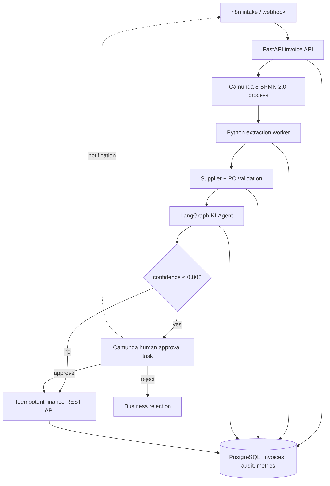

# Architecture

The BPMN source is [bpmn/invoice-approval.bpmn](../bpmn/invoice-approval.bpmn); it is the executable source of truth. PostgreSQL constraints and invoice IDs provide idempotency. Camunda job retries handle transient worker failures, while non-retryable validation failures become explicit business rejections. The agent supplies a structured classification, confidence, evidence, and explanation; deterministic policy decides whether a human is required.
